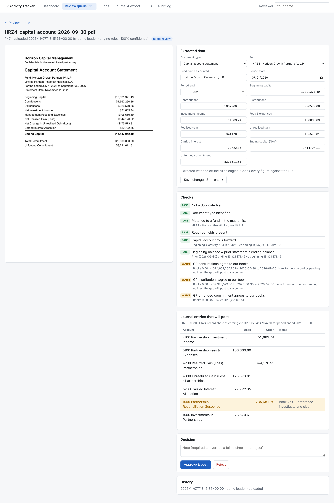

# LP Activity Tracker (prototype)

A working prototype for an alternative-investments operations team. It tracks every LP interest
and turns the PDFs downloaded from GP portals (capital calls, distributions, capital account
statements, financial statements, K-1s) into reviewed, balanced journal entries for the
investment accounting system.

> **Demo data only.** Everything in the sample data is synthetic. This repository is public; do not
> commit real statements, K-1s or fund names. The `data/` folder is git-ignored for that reason.



More screenshots (dashboard, review queue, fund detail) are in [`screenshots/`](screenshots/).

## What it does

```
PDF ──► intake ──► extract ──► match fund ──► validate ──► review queue ──► approve ──► journal entries ──► CSV export
         (hash,      (Claude or     (master list,   (roll-forward,   (side-by-side      (named reviewer,   (GL import file)
         dedupe)     offline rules)  aliases)        recon to books)  PDF + fields)      audit trail)
```

- **Intake:** drag PDFs into the review queue. Each file is fingerprinted (SHA-256), so a re-downloaded
  notice is flagged as a duplicate instead of being booked twice.
- **Extraction:** classifies the document and pulls out the fields for its type:
  - Capital call: investment / fee / expense split, due date
  - Distribution: return of capital / gain / income, withholding, net cash, recallable amount
  - Capital account statement: beginning and ending capital, contributions, distributions, income,
    expenses, realized and unrealized gain, carry, unfunded commitment
  - K-1: boxes 1, 5, 6a, 8, 9a and 19; final or estimate
  - Financial statements: fund-level net assets
- **Validation** (each check is pass / warn / fail, and a fail blocks approval):
  - Call components add to the total; the call fits within the unfunded commitment
  - Distribution components less withholding equal the net cash
  - The capital account rolls forward (beginning + activity = ending)
  - Beginning capital equals the prior statement's ending capital
  - GP-reported contributions, distributions and unfunded commitment agree to our books
  - The same transaction or period isn't already booked
  - K-1 box 19 agrees to booked distributions
- **Review:** the PDF sits next to the extracted fields. Reviewers can correct any field (checks re-run),
  override a failed check only with a written note, or reject. The reviewer's name and time are recorded.
- **Posting:** approved documents create balanced journal entries:

  | Document | Debit | Credit |
  |---|---|---|
  | Capital call | 1500 Investments in Partnerships | 2100 Capital Calls Payable |
  | Distribution | 1210 Distributions Receivable (net), 1350 Tax Withheld | 1500 Investments in Partnerships (gross) |
  | Capital account statement | NAV true-up of the investment account to the GP's ending capital, split into 4100 income, 5100 fees and expenses, 4200 realized, 4300 unrealized, 5200 carry | |
  | K-1, financial statements | Tracked only; nothing posts | |

  If our book activity for a period doesn't match the GP's (usually a notice not yet booked), the gap goes
  to **1599 Reconciliation Suspense**, so book NAV still equals GP NAV and the gap stays visible.
  Booking the missing notice later clears the suspense automatically.
- **Tracking:** the dashboard shows commitment, called, unfunded, distributed, book NAV, DPI and TVPI for
  each fund. It also lists outstanding items: missing quarterly statements, missing or estimate-only K-1s,
  and capital calls coming due, with the portal each one comes from.
- **Export:** a CSV in a generic GL-import layout. Each entry is exported once and tagged with a batch id.

The approach is NAV / fair-value basis (ASC 820 NAV practical expedient). Change account numbers in
`config/accounts.json`; changing the method means editing `altinv/posting.py`.

## Run it

Requires Python 3.10+.

```bash
pip install -r requirements.txt
```

```bash
python -m altinv.cli demo -y
```

```bash
python -m altinv.cli serve
```

Open http://127.0.0.1:8000 and type your name in the **Reviewer** box. The demo loads six fictional
funds with opening balances at 12/31/2025, approves Q1–Q2 2026 activity as history, and leaves Q3
documents in the review queue. Things to try:

1. Open the **HRZ4 Q3 capital account statement** before its Q3 calls. The recon checks warn, and the
   proposed entry shows the gap going to suspense. Approve the HRZ4 calls and distribution first, and
   the warnings clear.
2. Open the **SRE3 Q3 statement**. It doesn't roll forward because the GP statement has a $10,000 typo.
   Correct the unrealized gain and the check passes.
3. Try approving the **duplicate** HRZ4 call (`… (1).pdf`), or the **Bluewater** call from a fund
   that isn't in the master list.
4. Upload the PDFs in `data/samples/upload/` (new Q4 calls) from the review queue.
5. Export the journal from **Journal & export**.

Run the tests:

```bash
python -m pytest -q
```

## Extraction engines

- **Claude (meant for production):** sends the PDF itself (scanned PDFs work) and gets back a validated,
  typed result (`altinv/extract_llm.py`, model `claude-opus-5-5`, with automatic fallback if a request is
  declined). It's used automatically when Anthropic credentials are present
  (`ANTHROPIC_API_KEY`, or `ant auth login`). Force it with `ALTINV_EXTRACTOR=claude`. Get your firm's
  approval and check data-retention terms before sending real LP documents.
- **Rules (offline):** keyword and label matching (`altinv/extract_rules.py`). It handles the three
  sample GP layouts and simple text PDFs, but with ~100 GPs it will miss layouts it hasn't seen. Use it
  for demos and tests. Force it with `ALTINV_EXTRACTOR=rules`.

Either way, nothing posts without a named reviewer approving it.

## Layout

| Path | What |
|---|---|
| `altinv/models.py` | Extraction schema shared by both engines |
| `altinv/pipeline.py` | Intake, fund matching, edit / approve / reject |
| `altinv/validate.py` | The checks |
| `altinv/posting.py` | Journal entry rules and CSV export |
| `altinv/ledger.py` | Book balances: called, unfunded, NAV, suspense |
| `altinv/app.py` | Web API |
| `static/` | Browser UI (no build step) |
| `altinv/samples.py` | Synthetic funds and PDF notices |

## Not built yet (next steps)

- **Collecting documents from portals:** use a vendor (e.g. Canoe), a shared notification inbox, or a
  watched drop folder. Logging into 100 portals with scrapers is brittle.
- **Direct posting** through your accounting system's API instead of a CSV import. The export layout is
  generic and needs mapping to your system's template.
- **Multiple entities, FX, and non-USD funds**
- **User accounts and permissions:** today the app runs on localhost with a typed-in reviewer name.
  Production needs sign-in and maker-checker roles (preparer ≠ approver).
- **Postgres** instead of SQLite, and storing PDFs in your document system
- **Cash settlement:** matching capital calls to wires, and distributions to receipts from bank data

## Browser-only demo

`demo/build_demo.py` builds a single self-contained HTML page (`data/demo/index.html`) with the sample
data and an image of every PDF embedded, and the checks and posting rules re-implemented in
JavaScript. It needs no server, which makes it easy to share for a walkthrough. Nothing in it is saved,
and it can't read new PDFs; use the real app for that.

```bash
python demo/build_demo.py
```
